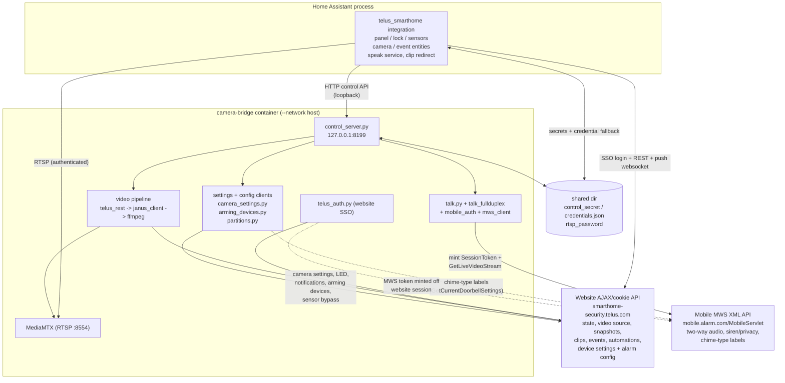

# Architecture

This project brings a TELUS Smart Home system — a white-labeled Alarm.com
deployment — into Home Assistant. TELUS ships no official API, so both halves of
this project are built by reverse-engineering the browser and mobile-app traffic
of a real account. This document is the map: it explains the two components, how
they talk, the two distinct Alarm.com backends the project speaks to, and the
end-to-end flow for each kind of data. For the deep detail on any one piece,
follow the cross-references to the sibling docs.

## The two components

The project is two independently-deployed processes that run on the **same
host**.

| Component | Lives in | Runtime | Responsible for |
| --- | --- | --- | --- |
| **Home Assistant integration** | `custom_components/telus_smarthome/` | Inside the Home Assistant process | Panel, lock, and sensor entities; camera/event entities; config & credential flows; clip-link redirect; talkdown service |
| **Camera bridge** | `camera-bridge/` | Standalone Docker container | Pulling live video over WebRTC and re-serving it as RTSP; snapshots; clip/event/history/automation lookups; two-way audio (talkdown) |

They are deliberately separate. The integration is a Home Assistant custom
component (a fork of the community `alarmdotcom` integration built on
`pyalarmdotcomajax`, with a TELUS SSO monkeypatch applied at import). The bridge
is a from-scratch Python service in its own container that has **no shared code
with the integration** — it reimplements the TELUS login independently. See
[integration.md](ha-integration.md) and [camera-bridge.md](camera-bridge.md) for
each component's internals.

### Why two processes, not one

Alarm.com's video platform has no RTSP or ONVIF interface — the only live-video
path is a proprietary Janus Gateway / WebRTC signaling flow. Janus negotiates a
wide ephemeral UDP port range for RTP that does not survive Docker's default
bridge networking and NAT, so the bridge must run with `--network host`. Rather
than force that networking model and a heavy media pipeline (ffmpeg, a bundled
MediaMTX RTSP server, hardware H.264 encode) into the Home Assistant process, the
video work is isolated in its own container. The integration stays a normal HA
component and simply **consumes** what the bridge produces. See
[camera-bridge.md](camera-bridge.md) for the media pipeline and
[network-and-deployment.md](setup.md) for the host-networking
requirement.

## The two Alarm.com backends

A subtle but central fact: the project speaks to **two different Alarm.com
backends**, because no single one exposes everything needed.

### 1. The website AJAX / cookie API — state and video

The TELUS-branded website backend (`smarthome-security.telus.com`) is the
primary backend. It is reached with a cookie-authenticated session established
through TELUS's SSO/OAuth gateway (a PingFederate IdP) rather than Alarm.com's
native login form — which is exactly why the stock `alarmdotcom` integration and
stock Alarm.com camera tooling do not work against a TELUS account. Once
authenticated, the REST and push-websocket API are identical to Alarm.com's own;
only the login handshake differs.

Both components authenticate to this backend, each with its own from-scratch
implementation of the SSO handoff:

- **Integration:** `telus_auth_patch.py` monkeypatches `pyalarmdotcomajax` so
  `AlarmController.async_login()` performs the TELUS SSO redirect chain (landing
  on `.../web/api/TokenSso.ashx`) before falling into the library's normal
  session code. All subsequent REST/websocket calls point at the TELUS host.
- **Bridge:** `bridge/telus_auth.py` is a separate, dependency-free
  reimplementation of the same OAuth/cookie dance, holding its own `aiohttp`
  session.

This backend serves **panel/lock/sensor state** (integration), the **live-video
source descriptors** — Janus gateway URL, token, ICE servers — that the bridge
feeds into WebRTC (`bridge/telus_rest.py`), **snapshots**, and the **clip /
event / activity / automation** data. Both SSO reimplementations were built from
HAR captures; see [telus-auth.md](alarm-com-api.md).

### 2. The legacy mobile "MWS" API — two-way audio, siren and privacy

There is one thing the website backend does **not** unlock: upstream (talkdown)
audio to a doorbell speaker. That capability is gated behind the **MWS (Mobile
Web Service)** — the legacy XML servlet the native Alarm.com mobile app uses, at
`mobile.alarm.com/MobileServlet/SubmitRequest.aspx`. Its `GetLiveVideoStream`
action is the only call that returns the `<webrtc>` / `<srtp>` upstream-audio
endpoints, and it requires an **MWS `SessionToken`**, which no website endpoint
mints.

The same session later turned out to be the only way to reach two more things —
the camera **siren** (`ManualSirenStart` / `ManualSirenStop`) and **privacy mode**
(`SetCameraPrivacyModeState`), which have no website equivalent. Those actions are
ordinary MWS form POSTs but answer **JSON** rather than XML, with the same
`isSuccess` / `ErrorMessage` envelope fields.

So the bridge mints one on demand, off the *website* session it already holds:
`bridge/mobile_auth.py` drives the mobile SSO servlet against the same IdP
session (a `SeamlessLoginNew` form POST in steady state, or an
`SSORedirectHandler.ashx?AppType=66` → `LoginAsLogin` bootstrap the first time),
parses the returned XML for the `SessionToken`, then `bridge/mws_client.py`
POSTs `GetLiveVideoStream` to resolve the talk endpoints. Apart from the siren
and privacy commands above, everything else uses backend #1 — including all the
camera settings and diagnostics. It is reverse-engineered
from the decompiled Android app and is documented in
[talkdown.md](talkdown-fullduplex-protocol.md).

| | Website AJAX/cookie API | Mobile MWS XML API |
| --- | --- | --- |
| Host | `smarthome-security.telus.com` | `mobile.alarm.com` |
| Auth | TELUS SSO → cookie session | MWS `SessionToken` minted off the website session |
| Wire format | JSON (REST) + push websocket | form POST → XML (the siren/privacy actions answer JSON) |
| Used by | integration **and** bridge | bridge only |
| Provides | state, live-video source, snapshots, clips, events, activity, automations, camera settings + diagnostics | doorbell two-way audio endpoints, camera siren, privacy mode |
| Why | primary backend for everything | only backend that exposes upstream audio, the siren, and privacy mode |

## How the two components communicate

The integration and the bridge share the host but not a process, so they
coordinate over two local channels.

### Loopback control HTTP API

The bridge runs a small `aiohttp` listener (`bridge/control_server.py`) bound to
`127.0.0.1:8199`. Because both containers use `--network host`, that loopback is
the host's own loopback, reachable from the HA container but never exposed off
the box. The integration is a pure **client** of this API. Key endpoints:

| Endpoint | Method | Purpose |
| --- | --- | --- |
| `/control/credentials` | POST | Live credential push from HA (Bearer auth) |
| `/control/health` | GET | Liveness, no auth |
| `/control/cameras` | GET | Current camera list + RTSP publish URLs (polled) |
| `/control/status` | GET | Per-camera session diagnostics |
| `/control/cameras/{id}/snapshot` | GET | On-demand still (real round trip to TELUS) |
| `/control/cameras/{id}/talk` | POST | Talkdown — fetch and play an audio URL |
| `/control/events` | GET | Recent camera clip events |
| `/control/clip/{video_event_id}` | GET | Re-mint a fresh signed download URL for one clip |
| `/control/history` | GET | System-wide activity feed |
| `/control/automations` | GET | Video automation rules (+ `/pause`, `/resume`) |
| `/control/cameras/{id}/settings` | GET | Camera audio/image/video settings (writes are POSTs to the per-facet sub-routes `/settings/{volume,chime,led,notifications,image,video}`, each a read-modify-write) |
| `/control/cameras/{id}/diagnostics` | GET | Camera signal strength, battery, device status |
| `/control/cameras/{id}/siren`, `/privacy` | POST | Camera siren and privacy mode (mobile MWS backend) |

The integration's matching URLs are defined in `const.py`
(`CAMERA_BRIDGE_*_URL`). See [control-api.md](control-api.md) for full
request/response shapes.

### Shared directory (credential & secret handoff)

The same host directory is bind-mounted into both containers — `/share/telus_cam_bridge`
in HA, `/shared` in the bridge (host path
`/var/lib/homeassistant/share/telus_cam_bridge` by default). It carries the
secrets and fallbacks the loopback API cannot bootstrap on its own:

| File | Written by | Read by | Purpose |
| --- | --- | --- | --- |
| `control_secret` | bridge (first start, auto-rotated) | integration | Bearer secret for the credential push |
| `credentials.json` | integration (every credential update) | bridge (startup + 30s watcher) | Credential fallback if the live push is missed |
| `rtsp_password` | bridge (`entrypoint.sh`, mode `0600`) | bridge | Baked into the RTSP URLs the bridge publishes and reports |
| `mobile_auth.json` | bridge (`mobile_auth.py`) | bridge | Persisted mobile-session state: a stable synthetic device uid plus the rolling seamless-login token, so a restart re-logs-in silently instead of re-running the full SSO bootstrap. Never holds the short-lived session token |
| `restart_guard.json` | bridge | bridge | Cross-process crash-loop guard |

The credential handoff is deliberately belt-and-suspenders: when TELUS
credentials change via HA's reauth/reconfigure flow, the integration **always**
writes `credentials.json` first, then makes a **best-effort, non-blocking** push
to `/control/credentials`. The bridge applies a live push immediately, and
independently adopts `credentials.json` at startup and re-checks it every 30s — so
a change reaches the bridge immediately, or within 30s, or at next start,
whichever comes first, and HA's own credential update never blocks on the bridge
being reachable. See [credential-sync.md](control-api.md).

## End-to-end data & control flows

### State (panel / lock / sensors)

Handled entirely by the integration against the **website backend**. A push
websocket delivers changes in well under a second; a REST poll (default 300s) is
only a backstop for events lost during the ~6-minute server-forced socket
reconnect. See [integration.md](ha-integration.md) and [latency.md](ha-integration.md).

### Live video

1. Integration polls `/control/cameras` and creates a camera entity per camera,
   reading the RTSP URL (password included) straight from the bridge.
2. Bridge, per camera: logs into the website backend, fetches the Janus video
   source (`telus_rest.py`), runs the WebRTC signaling (`janus_client.py`),
   decodes frames, and publishes them via ffmpeg to the bundled MediaMTX RTSP
   server (`ffmpeg_sink.py`).
3. HA (and its bundled go2rtc) consumes ordinary authenticated RTSP.

Alarm.com force-closes each video session at ~180s server-side, so the bridge
proactively rotates every session at 165s and bridges the gap by holding the last
frame — see [camera-bridge.md](camera-bridge.md).

### Snapshots

Integration calls `/control/cameras/{id}/snapshot`; the bridge does a real round
trip to the website backend for a one-shot signed JPEG URL. For "who was at the
door", clip thumbnails are usually preferred over live stills — see
[snapshots-and-clips.md](control-api.md).

### Events, clips, and activity

Integration polls `/control/events` and `/control/history` (via shared
coordinators) to populate `event.*` and activity entities. The signed
`download_url` on a clip expires within minutes, so durable phone notifications
use a signed `clip_link` that hits an unauthenticated HA redirect view
(`clip_view.py`), which re-mints a fresh URL at tap time via
`/control/clip/{id}`. See [snapshots-and-clips.md](control-api.md).

### Talkdown (two-way audio)

The integration's `speak` service renders TTS to a loopback media URL and POSTs
it to `/control/cameras/{id}/talk`. The bridge then uses the **mobile MWS
backend** (mint `SessionToken` → `GetLiveVideoStream` → WebRTC/SRTP talk
transport) to play it through the doorbell speaker. Enabled by default on the
bridge (`TALKDOWN_ENABLED`); set it `false` to make the route refuse with
`403 talkdown_disabled`. See [talkdown.md](talkdown-fullduplex-protocol.md).

### Device settings and alarm configuration

Added after the original two flows and worth calling out separately, because it
is the one area where the bridge is doing something other than moving video or
audio: it is a settings client.

`camera_settings.py`, `arming_devices.py` and `partitions.py` all speak the
**website** API and all share one shape — a JSON:API read, a **flat** write, and
a whole-document read-modify-write, because a settings PUT replaces the entire
object rather than patching it. Every field is paired with a capability flag that
is checked before a control is offered or applied, and absence of a flag counts
as "unsupported" rather than "allowed".

What flows through them: the camera settings (speaker volume, chime, image, clip
and live-stream resolution, status LED, TELUS-side push notifications), the
diagnostics, the Bluetooth arming devices (whether a paired phone may disarm the
panel), and selective sensor bypass.

One thing crosses backends. The **chime-type option labels** come from the mobile
API's `GetCurrentDoorbellSettings`, because the website publishes those options as
bare integers and names them only in the portal's own JavaScript. That read is
cached for an hour — the option list is a property of the hardware, not state.

The two alarm-side capabilities are treated with more caution than the rest, and
the docs say why in each place: an arming-device write decides whether a phone
walking up to the house disarms the alarm, and a bypassed sensor stops triggering
it until it is put back.

## Component diagram

## Where to go next

- [ha-integration.md](ha-integration.md) — the Home Assistant custom component
- [camera-bridge.md](camera-bridge.md) — the standalone video/RTSP service
- [alarm-com-api.md](alarm-com-api.md) — the website SSO handshake and backend API (both implementations)
- [talkdown-fullduplex-protocol.md](talkdown-fullduplex-protocol.md) — the mobile MWS two-way-audio path
- [control-api.md](control-api.md) — the loopback control HTTP endpoints and credential handoff
- [configuration.md](configuration.md) — every configurable knob across both halves
- [setup.md](setup.md) — host networking and installation
- [troubleshooting.md](troubleshooting.md) — symptom → cause → fix across both components
